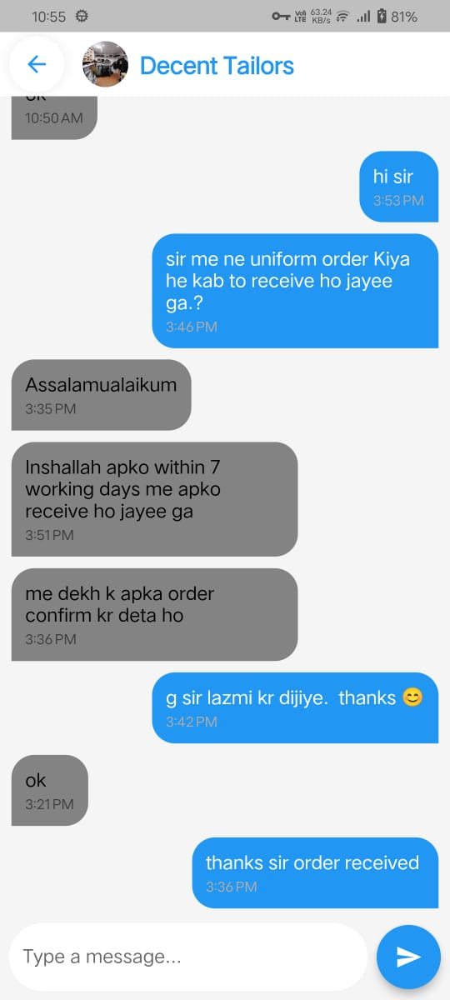
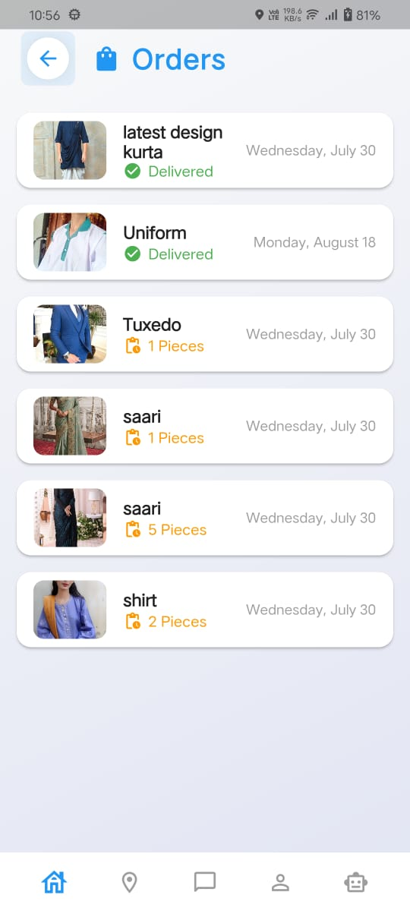
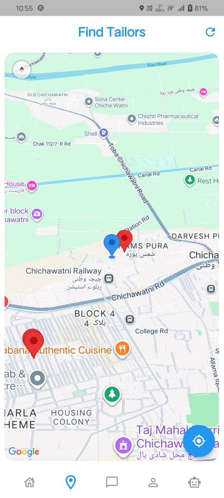
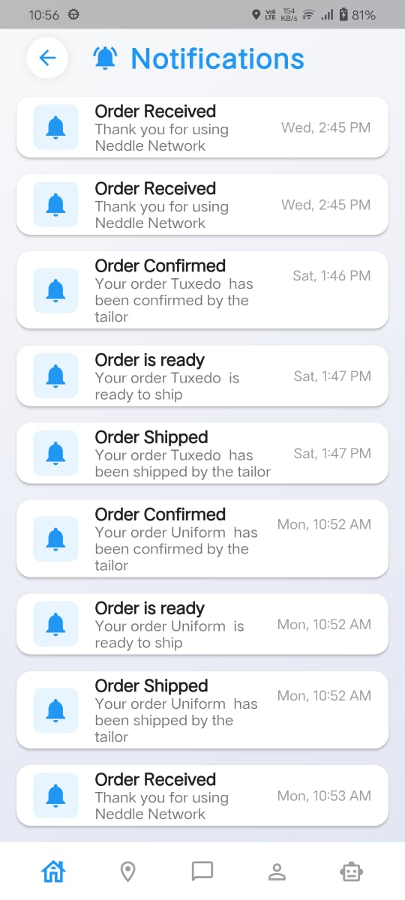

<div align="center">

# 🧵 Needle Network Main


*A comprehensive Flutter application for connecting users with tailors, featuring seamless authentication, product management, and real-time communication.*

[](https://flutter.dev/)
[](https://dart.dev/)
[](https://firebase.google.com/)
[](LICENSE)

</div>

## 📋 Table of Contents
- [Installation](#installation)
- [Features](#features)
- [Screenshots](#screenshots)
- [Tech Stack](#tech-stack)
- [Usage](#usage)
- [Contributing](#contributing)
- [License](#license)
- [Support](#support)

## 🚀 Installation

Follow these steps to get the project up and running on your local machine:

1. **Clone the repository**
   ```bash
   git clone https://github.com/your-username/needle_network_main.git
   cd needle_network_main
   ```

2. **Install dependencies**
   ```bash
   flutter pub get
   ```

3. **Set up Firebase**
   - Create a Firebase project at [Firebase Console](https://console.firebase.google.com/)
   - Add your `google-services.json` (Android) and `GoogleService-Info.plist` (iOS) files
   - Enable Authentication, Firestore, Realtime Database, and Storage

4. **Run the app**
   ```bash
   flutter run
   ```

## ✨ Features

- 🔐 **Authentication**: Secure login/signup with email verification and password reset
- 🛍️ **Product Management**: Browse and manage tailor products with detailed listings
- 📦 **Order Management**: Place custom orders and track order status
- 💬 **Real-time Chat**: Communicate with tailors and AI chatbot assistance
- 🗺️ **Location Services**: Find nearby tailors using Google Maps integration
- 🔔 **Notifications**: Stay updated with push notifications
- 📱 **Responsive UI**: Optimized for mobile devices with persistent navigation

## 📸 Screenshots

<div align="center">

| 🏠 Main Page - Dashboard | 💬 Chat Screen | 📦 Orders Page |
|:---:|:---:|:---:|
|  |  |  |

| 🤖 AI Chatbot | 🗺️ Map | 🔔 Notifications |
|:---:|:---:|:---:|
|  |  |  |

| 🤖 AI Chatbot 1 | 
|:---:|
|  |

</div>

## 🛠️ Tech Stack

| Category | Technologies |
|----------|--------------|
| **Framework** | Flutter, Dart |
| **Backend** | Firebase (Auth, Firestore, Realtime DB, Storage) |
| **State Management** | Provider |
| **Maps** | Google Maps Flutter |
| **Navigation** | Persistent Bottom Navigation Bar |
| **UI Components** | Material Design, Cupertino Icons |
| **Additional** | Geocoding, Geolocator, Image Picker, HTTP |

## 📖 Usage

1. **Sign Up/Login**: Create an account or log in with existing credentials
2. **Browse Products**: Explore available tailor products and services
3. **Place Orders**: Customize and place orders for tailoring services
4. **Chat**: Communicate with tailors or use AI chatbot for assistance
5. **Track Location**: Find nearby tailors on the integrated map
6. **Manage Account**: Update profile information and preferences

## 🤝 Contributing

We welcome contributions! Please follow these steps:

1. Fork the repository
2. Create a feature branch (`git checkout -b feature/AmazingFeature`)
3. Commit your changes (`git commit -m 'Add some AmazingFeature'`)
4. Push to the branch (`git push origin feature/AmazingFeature`)
5. Open a Pull Request

## 📄 License

This project is licensed under the MIT License - see the [LICENSE](LICENSE) file for details.

## 💬 Support

If you find this project helpful, please give it a ⭐ star!

For questions or support, feel free to open an issue or contact the maintainers.

---

<div align="center">

**Made with ❤️ using Flutter**

</div>
